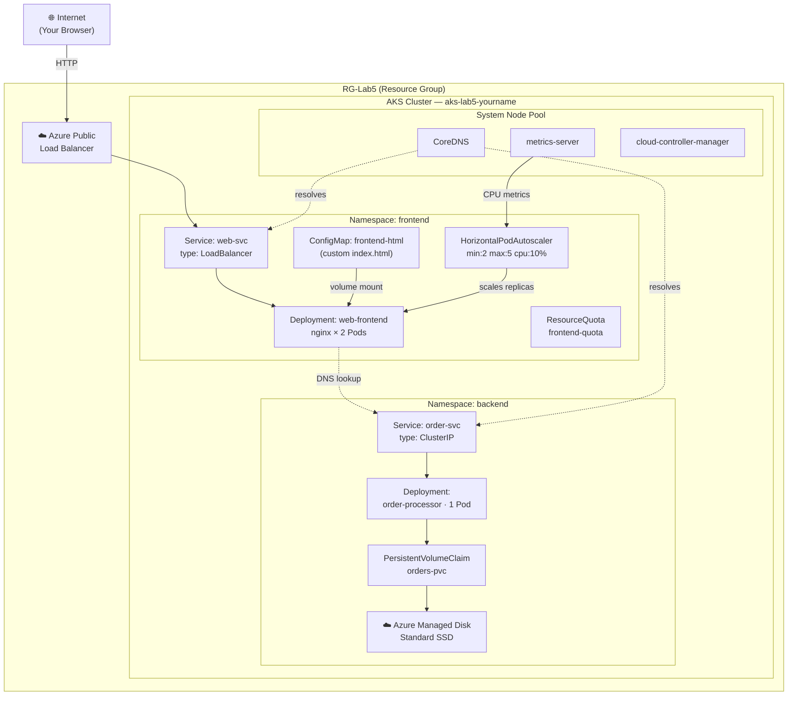

---
lab:
  title: 'Lab Day 5: Kubernetes – Azure Kubernetes Service (AKS)'
  module: 'Advanced Azure Bootcamp – Day 5'
---

# Lab Day 5 – Kubernetes: Azure Kubernetes Service (AKS)

## Lab Introduction

In this lab you deploy and operate a workload on Azure Kubernetes Service (AKS). You
will work through the core operational tasks a platform engineer performs when running
containerised applications on a managed Kubernetes cluster. You will work through the
following tasks:

- Provision an AKS cluster and connect to it with `kubectl`
- Explore cluster structure: nodes, namespaces, and system workloads
- Deploy an application using a Kubernetes Deployment and inspect Pod lifecycle
- Expose the application externally using a Kubernetes Service of type LoadBalancer
- Perform a rolling update and observe zero-downtime deployment behaviour
- Attach persistent storage using a PersistentVolumeClaim backed by Azure Disks
- Apply operational patterns: resource quotas, Horizontal Pod Autoscaler, and namespace isolation

## Pre-requisites

- An Azure subscription
- A resource group named **RG-Lab5**.
  Note: You will be assigned your own unique resource group name in the sandbox environment to avoid conflicts with other participants. Create a resource group in the same region you will deploy resources to (e.g., Australia East). Name the resource group RG-Lab5-yourname. Note the resource group name for use in all lab tasks.
- Owner rights at the resource group level
- Azure Cloud Shell (browser-based) — no local tooling installation required

## Estimated Timing: 90 minutes

## Lab Scenario

Your organisation is modernising a retail order management platform. The development
team has already containerised two microservices:

- A **front-end web application** (`nginx`-based) that serves the order entry UI
- A **stateful order processor** that writes order data to a persistent volume

Your task is to deploy both workloads onto a shared AKS cluster, expose the front-end
to the internet, demonstrate a zero-downtime update, and attach durable storage to the
order processor. You will then apply operational guardrails — resource quotas, autoscaling,
and namespace separation — that reflect production-ready cluster practices.

## Architecture Overview

```
RG-Lab5 (Resource Group)
└── AKS Cluster (aks-lab5-yourname)
    ├── agentpool / System Node Pool (Standard_D2s_v3 × 1)
    │   └── Namespace: kube-system  (AKS-managed)
    │       ├── CoreDNS
    │       ├── metrics-server
    │       └── cloud-controller-manager
    │
    └── userpool / User Node Pool (Standard_D2s_v3 × 2)    — application workloads
        │
        ├── Namespace: frontend
        │   ├── Deployment: web-frontend  (nginx)
        │   │   └── ReplicaSet → 2 × Pod
        │   └── Service: web-svc  (type: LoadBalancer → Azure Public IP)
        │
        └── Namespace: backend
            ├── Deployment: order-processor
            │   └── Pod → /data mount
            ├── PersistentVolumeClaim: orders-pvc
            │   └── PersistentVolume — Azure Managed Disk (Standard_LRS)
            └── Service: order-svc  (type: ClusterIP — internal only)
```



## Job Skills

- Task 1: Provision an AKS cluster and connect with kubectl
- Task 2: Explore cluster structure — nodes, namespaces, and system workloads
- Task 3: Deploy an application using a Kubernetes Deployment
- Task 4: Expose the application with a LoadBalancer Service
- Task 5: Perform a rolling update and observe zero-downtime behaviour
- Task 6: Attach persistent storage with a PersistentVolumeClaim
- Task 7: Apply operational patterns — resource limits, autoscaling, and namespace isolation

---

## Task 1: Provision an AKS Cluster and Connect with kubectl

Azure Kubernetes Service (AKS) is a managed Kubernetes offering. Azure provisions
and manages the Kubernetes control plane (API server, etcd, scheduler) at no additional
cost; you pay only for the agent nodes that run your workloads.

### Create the AKS cluster

1. In the Azure portal, search for and select **Kubernetes services**.

2. Select **+ Create** → **Create a Kubernetes cluster** and configure the **Basics** tab:

   | Setting | Value |
   | --- | --- |
   | Resource group | **RG-Lab5** |
   | Kubernetes cluster name | `aks-lab5-yourname` (replace *yourname* to keep it unique) |
   | Region | **Australia East** |
   | Availability zones | **None** (cost saving for lab) |
   | AKS Pricing tier | **Free** |
   | Kubernetes version | Accept the default (latest stable) |
   | Automatic upgrade | **Enabled with patch (recommended)** — leave default |
   | Authentication and Authorization | **Local accounts with Kubernetes RBAC** |

3. Select the **Node pools** tab. You will see two node pools: **agentpool** (System) and **userpool** (User).

   Select **agentpool** to edit it and configure:

   | Setting | Value |
   | --- | --- |
   | Node size | **Standard_D2s_v3** (select **Choose a size**, search for `D2s_v3`) |
   | Scale method | **Manual** |
   | Node count | `1` |

   Select **Update** to save.

   Then select **userpool** and configure:

   | Setting | Value |
   | --- | --- |
   | Node size | **Standard_D2s_v3** |
   | Scale method | **Manual** |
   | Node count | `2` |

   Select **Update** to save the node pool changes.

   > **Why these counts?** The **agentpool** (System) runs only AKS system components
   > such as CoreDNS, Cilium, and the CSI drivers — one node is sufficient for a lab.
   > The **userpool** (User) is where your application Pods land. Two nodes are needed
   > so the Kubernetes scheduler can spread the two `web-frontend` replicas across
   > separate nodes, demonstrating fault tolerance: if one user node goes down, the
   > other replica on the remaining node keeps the application available.

4. Select the **Networking** tab and review:

   | Setting | Value |
   | --- | --- |
   | Network configuration | **Azure CNI Overlay** (default — leave as-is) |
   | DNS name prefix | Accept the default |
   | Enable Cilium dataplane and network policy engine | Leave as default |

   > **Azure CNI Overlay vs Azure CNI Node Subnet:** With Azure CNI Overlay, Pods
   > receive IPs from a private overlay address space separate from the VNet — this
   > is more scalable and is now the default. Azure CNI Node Subnet (previously just
   > called "Azure CNI") assigns each Pod a VNet IP directly, which is required when
   > Pods must be reachable by other VNet resources by IP. Azure CNI Overlay is
   > sufficient for this lab.

5. Select the **Monitoring** tab and **disable all monitoring options** to keep the
   lab resource count low and avoid extra charges:

   | Setting | Value |
   | --- | --- |
   | Enable Container Logs | **Off** (disables Container Insights) |
   | Enable Prometheus metrics | **Off** (otherwise Azure creates a Monitor workspace + Grafana instance) |
   | Enable Managed Grafana | **Off** |
   | Enable recommended alert rules | **Off** (uncheck the checkbox) |

   > **Why this matters:** Leaving these options enabled causes Azure to automatically
   > provision extra resources — an Azure Monitor workspace, Azure Managed Grafana,
   > Prometheus rule groups, data collection rules, metric alert rules, and email
   > alert notifications. For this lab you only need the Kubernetes service itself.

6. Select **Review + Create**, then **Create**. Provisioning takes 4–6 minutes.

### Connect to the cluster with kubectl

1. Once deployment completes, navigate to the `aks-lab5-yourname` resource.

2. Select **Connect** from the top toolbar. The portal displays the commands needed
   to configure `kubectl` credentials.

3. Open **Azure Cloud Shell** (the `>_` icon in the portal toolbar). Select **Bash**.
   If prompted, create a storage account to persist Cloud Shell files.

4. In Cloud Shell, run the following commands (substitute your resource group and
   cluster name):

   ```bash
   az aks get-credentials \
     --resource-group RG-Lab5 \
     --name aks-lab5-yourname \
     --overwrite-existing
   ```

   This writes the cluster's `kubeconfig` to `~/.kube/config` in your Cloud Shell
   session, configuring `kubectl` to talk to this cluster.

5. Verify the connection:

   ```bash
   kubectl get nodes
   ```

   Expected output (three nodes in the **Ready** state):

   ```
   NAME                                STATUS   ROLES    AGE     VERSION
   aks-agentpool-30245557-vmss000000   Ready    <none>   5m10s   v1.33.7
   aks-userpool-30245557-vmss000000    Ready    <none>   5m6s    v1.33.7
   aks-userpool-30245557-vmss000001    Ready    <none>   5m24s   v1.33.7
   ```

   > If you see **NotReady**, wait 60 seconds and re-run the command. Nodes may still
   > be completing their bootstrap sequence.

---

## Task 2: Explore Cluster Structure — Nodes, Namespaces, and System Workloads

Before deploying your own workloads, it is important to understand what AKS has
already provisioned inside the cluster.

### Inspect nodes

1. Retrieve detailed information about one node:

   ```bash
   kubectl describe node $(kubectl get nodes -o jsonpath='{.items[0].metadata.name}')
   ```

   Scroll through the output and note:
   - **Allocatable** resources — the CPU and memory available to schedule Pods on
     this node (less than Capacity because the OS and AKS system daemons consume some)
   - **Conditions** — the standard Kubernetes conditions (Ready, MemoryPressure,
     DiskPressure, PIDPressure) plus several AKS-specific conditions added by the
     node-problem-detector (e.g. KernelDeadlock, FrequentContainerdRestart,
     NetworkUnavailable). This is normal — all should show `False` or `True` for Ready.
   - **System Info** — kernel version, container runtime (containerd), kubelet version.
     Note: **Kube-Proxy Version** will be blank on clusters using the Cilium dataplane,
     because Cilium replaces kube-proxy for service routing.

### Explore namespaces

2. List all namespaces in the cluster:

   ```bash
   kubectl get namespaces
   ```

   AKS provisions several namespaces by default:

   | Namespace | Purpose |
   | --- | --- |
   | `default` | Where resources are created when no namespace is specified |
   | `kube-system` | Kubernetes and AKS system components |
   | `kube-public` | Metadata readable by unauthenticated clients |
   | `kube-node-lease` | Node heartbeat lease objects (internal use) |

### Review system Pods

3. List the Pods running in the `kube-system` namespace:

   ```bash
   kubectl get pods -n kube-system
   ```

   You will see AKS-managed system components including:

   | Component | Role |
   | --- | --- |
   | `coredns-*` | In-cluster DNS — resolves Service names to ClusterIP addresses |
   | `coredns-autoscaler-*` | Adjusts CoreDNS replica count as the cluster grows |
   | `metrics-server-*` | Exposes resource metrics (CPU/memory) used by HPA and `kubectl top` |
   | `cloud-node-manager-*` | Integrates nodes with Azure (attaches Managed Disks, assigns LoadBalancer IPs) |
   | `cilium-*` / `cilium-operator-*` | eBPF-based networking and service routing — replaces kube-proxy on this cluster |
   | `azure-cns-*` | Azure Container Networking Service — manages pod IP allocation for CNI Overlay |
   | `csi-azuredisk-node-*` | CSI driver that mounts Azure Managed Disks into Pods |
   | `csi-azurefile-node-*` | CSI driver that mounts Azure Files shares into Pods |
   | `konnectivity-agent-*` | Secure tunnel between the AKS control plane and agent nodes |
   | `azure-policy-*` | Enforces Azure Policy rules inside the cluster |

   > **Note:** You will see more Pods than listed above — AKS deploys additional
   > components such as the workload-identity webhook (`azure-wi-webhook-*`) and the
   > image-cleaner (`eraser-*`). All Pods should show **Running** status. A small
   > number of recent restarts (1–2) on webhook Pods during startup is normal.

   > **Important:** Never delete or modify resources in `kube-system`. This namespace
   > is managed entirely by AKS. Changes may break cluster networking, DNS resolution,
   > or storage attachment.

### Create application namespaces

4. Create two namespaces for your workloads:

   ```bash
   kubectl create namespace frontend
   kubectl create namespace backend
   ```

5. Confirm they appear in the namespace list:

   ```bash
   kubectl get namespaces
   ```

---

## Task 3: Deploy an Application Using a Kubernetes Deployment

A **Deployment** is the standard Kubernetes object for managing stateless application
workloads. It declares the desired state — which container image to run, how many
replicas, resource limits — and the Deployment controller continuously reconciles
actual state to match.

### Create the front-end ConfigMap

A **ConfigMap** stores non-sensitive configuration data as key-value pairs. Here you
use one to inject a custom `index.html` into the nginx container via a volume mount,
so the page reflects the retail scenario rather than the generic nginx placeholder.

1. In Cloud Shell, create the ConfigMap manifest:

   ```bash
   cat <<'EOF' > web-frontend-configmap.yaml
   apiVersion: v1
   kind: ConfigMap
   metadata:
     name: web-frontend-html
     namespace: frontend
   data:
     index.html: |
       <!DOCTYPE html>
       <html lang="en">
       <head>
         <meta charset="UTF-8" />
         <title>Retail Order Entry — Microsoft</title>
         <style>
           body { font-family: Arial, sans-serif; background: #f4f6f8; display: flex; justify-content: center; align-items: center; height: 100vh; margin: 0; }
           .card { background: white; border-radius: 8px; padding: 48px 64px; box-shadow: 0 2px 12px rgba(0,0,0,0.1); text-align: center; max-width: 480px; }
           h1 { color: #0078d4; margin-bottom: 8px; }
           p  { color: #555; line-height: 1.6; }
           .badge { display: inline-block; margin-top: 24px; padding: 6px 16px; background: #e6f2fb; color: #0078d4; border-radius: 4px; font-size: 0.85rem; }
         </style>
       </head>
       <body>
         <div class="card">
           <h1>Retail Order Entry</h1>
           <p>Welcome to the Microsoft order management portal.<br/>
              This front-end is served by <strong>nginx</strong> running inside an
              AKS Pod, exposed via an Azure Load Balancer.</p>
           <div class="badge">Azure Kubernetes Service — Lab Day 5</div>
         </div>
       </body>
       </html>
   EOF
   ```

   > **What this manifest does:** It creates a ConfigMap named `web-frontend-html` in
   > the `frontend` namespace with a single key, `index.html`, whose value is the full
   > HTML page. Later, the Deployment mounts this key as a file at
   > `/usr/share/nginx/html/index.html` inside the nginx container, replacing the
   > default nginx placeholder page with the custom Retail Order Entry page.

2. Apply the ConfigMap:

   ```bash
   kubectl apply -f web-frontend-configmap.yaml
   ```

   Confirm it was created:

   ```bash
   kubectl get configmap web-frontend-html -n frontend
   ```

### Create the front-end Deployment

3. Create a manifest file for the front-end Deployment. Note the `volumeMounts` and
   `volumes` sections that mount the ConfigMap's `index.html` over nginx's default
   web root:

   ```bash
   cat <<'EOF' > web-frontend-deployment.yaml
   apiVersion: apps/v1
   kind: Deployment
   metadata:
     name: web-frontend
     namespace: frontend
     labels:
       app: web-frontend
   spec:
     replicas: 2
     selector:
       matchLabels:
         app: web-frontend
     template:
       metadata:
         labels:
           app: web-frontend
       spec:
         containers:
           - name: nginx
             image: nginx:1.25
             ports:
               - containerPort: 80
             resources:
               requests:
                 cpu: "100m"
                 memory: "64Mi"
               limits:
                 cpu: "250m"
                 memory: "128Mi"
             volumeMounts:
               - name: html-content
                 mountPath: /usr/share/nginx/html/index.html
                 subPath: index.html
         volumes:
           - name: html-content
             configMap:
               name: web-frontend-html
   EOF
   ```

   > **What this manifest does:** It creates a Deployment named `web-frontend` in the
   > `frontend` namespace with `replicas: 2` — meaning Kubernetes will always keep two
   > Pods running. The `selector.matchLabels` ties the Deployment to Pods labelled
   > `app: web-frontend`. Each Pod runs the `nginx:1.25` container with CPU and memory
   > requests/limits set, and mounts the `web-frontend-html` ConfigMap as a file at
   > `/usr/share/nginx/html/index.html` using `volumeMounts` + `subPath`, so nginx
   > serves the custom page instead of its default placeholder.

4. Apply the manifest:

   ```bash
   kubectl apply -f web-frontend-deployment.yaml
   ```

5. Watch the Pods come up (press `Ctrl+C` to stop watching):

   ```bash
   kubectl get pods -n frontend --watch
   ```

   Within 30–60 seconds both Pods should reach the **Running** state.

### Inspect the Deployment and Pods

6. Describe the Deployment to review its status:

   ```bash
   kubectl describe deployment web-frontend -n frontend
   ```

   Note the **Replicas** line: `2 desired | 2 updated | 2 total | 2 available`.

7. List the Pods with additional detail:

   ```bash
   kubectl get pods -n frontend -o wide
   ```

   The `-o wide` flag shows which **node** each Pod is running on. With two nodes
   and two Pods, the scheduler will typically spread them across both nodes for
   fault tolerance.

8. View the logs for one of the Pods (substitute the Pod name from the previous output):

   ```bash
   kubectl logs -n frontend <pod-name>
   ```

   You will see the nginx access log. The Pod has not received any traffic yet, so
   the log will be near-empty.

### Simulate a Pod failure

9. Delete one of the Pods to observe self-healing:

   ```bash
   kubectl delete pod -n frontend <pod-name>
   ```

10. Immediately run:

    ```bash
    kubectl get pods -n frontend
    ```

    The deleted Pod disappears and the Deployment controller immediately schedules a
    replacement. Within a few seconds you will see a new Pod in the **ContainerCreating**
    → **Running** state. The Deployment always reconciles back to `replicas: 2`.

    > **Key concept:** You never manage individual Pods directly in production.
    > You manage Deployments. The Deployment controller manages Pods on your behalf
    > and replaces any that fail or are deleted.

---

## Task 4: Expose the Application with a LoadBalancer Service

Pods have ephemeral IP addresses that change each time a Pod is replaced. A
**Service** provides a stable virtual IP (ClusterIP) and DNS name that load-balances
traffic across all healthy Pods matching its selector. A Service of type
**LoadBalancer** additionally provisions an Azure Public Load Balancer with a public IP.

### Create the LoadBalancer Service

1. Create the Service manifest:

   ```bash
   cat <<'EOF' > web-frontend-service.yaml
   apiVersion: v1
   kind: Service
   metadata:
     name: web-svc
     namespace: frontend
   spec:
     type: LoadBalancer
     selector:
       app: web-frontend
     ports:
       - protocol: TCP
         port: 80
         targetPort: 80
   EOF
   ```

   > **What this manifest does:** It creates a Service named `web-svc` in the `frontend`
   > namespace of type `LoadBalancer`. The `selector` matches any Pod labelled
   > `app: web-frontend` — the same label the Deployment applies to its Pods. Kubernetes
   > uses this selector to build an Endpoints list and load-balance incoming traffic across
   > all matching Pods. The `port: 80` is the port the Azure Load Balancer listens on
   > externally; `targetPort: 80` is the port inside each Pod (where nginx is listening).
   > Because the type is `LoadBalancer`, AKS instructs the Azure cloud-controller-manager
   > to provision a public Azure Load Balancer and assign it a public IP — which becomes
   > the Service's `EXTERNAL-IP`.

2. Apply the manifest:

   ```bash
   kubectl apply -f web-frontend-service.yaml
   ```

3. Watch until an external IP is assigned (this triggers Azure to provision a Public
   Load Balancer — takes 60–90 seconds):

   ```bash
   kubectl get service web-svc -n frontend --watch
   ```

   When the **EXTERNAL-IP** column changes from `<pending>` to an IP address, press
   `Ctrl+C`.

4. Copy the external IP address and open it in a browser tab. You should see the
   **Retail Order Entry** page — the custom HTML injected via the ConfigMap, served
   by nginx, and publicly accessible through the Azure Load Balancer. This confirms
   that the ConfigMap volume mount replaced nginx's default `index.html` correctly.

### Verify Service resilience

5. Delete one of the running Pods to verify the website stays up:

   ```bash
   kubectl delete pod -n frontend $(kubectl get pod -n frontend -l app=web-frontend -o jsonpath='{.items[0].metadata.name}')
   ```

6. Immediately refresh the browser tab with the external IP. The **Retail Order Entry**
   page should still load without any error. The Azure Load Balancer detects the Pod
   is gone and routes all traffic to the remaining Pod within seconds. Meanwhile,
   the Deployment controller schedules a replacement Pod.

7. Confirm the replacement Pod has started:

   ```bash
   kubectl get pods -n frontend
   ```

   You should see the old Pod terminating and a new Pod entering `ContainerCreating`
   → `Running`. Within a few seconds both Pods are Running again.

   > **Why this works:** The `web-svc` LoadBalancer Service tracks healthy Pod
   > endpoints continuously. When a Pod is deleted, it is immediately removed from
   > the Endpoints list and the Load Balancer stops sending traffic to it — before the
   > Pod is even fully terminated. The second Pod absorbs all traffic with no
   > downtime. This is the same mechanism that makes rolling updates zero-downtime.

### Understand Service DNS

8. Examine the Service details:

   ```bash
   kubectl describe service web-svc -n frontend
   ```

   Note the following fields in the output:
   - **`IP`** — the Service's ClusterIP. This is the stable internal IP that other
     Pods inside the cluster use to reach this Service.
   - **`LoadBalancer Ingress`** — the public IP assigned by Azure (shown as `(VIP)`).
     This is what you opened in the browser in step 4.
   - **`NodePort`** — a port automatically allocated on every node. Kubernetes uses
     this internally to route Load Balancer traffic from the Azure LB through each
     node to the Pod. You do not need to use or open this port directly.
   - **`Endpoints`** — the actual Pod IPs currently registered behind the Service
     (one per running `web-frontend` Pod). If a Pod is unhealthy, its IP is removed
     from this list automatically.

   The Service is also reachable inside the cluster by DNS name:

   ```
   web-svc.frontend.svc.cluster.local
   ```

   CoreDNS resolves this name to the ClusterIP automatically. Any Pod in any
   namespace can reach the Service using this FQDN without knowing the IP address.

**Service type comparison:**

| Type | Accessibility | Azure resource provisioned | Use case |
| --- | --- | --- | --- |
| **ClusterIP** | Internal only (within cluster) | None | Service-to-service communication |
| **NodePort** | Via node IP + port | None | Dev/test; direct node access |
| **LoadBalancer** | Public internet or internal VNet | Azure Public (or Internal) Load Balancer | External-facing applications |
| **ExternalName** | DNS alias to external FQDN | None | Routing to external services by DNS |

> **In summary:** Use **ClusterIP** for internal pod-to-pod traffic (the default — no
> external exposure). Use **LoadBalancer** when you need a public endpoint (Azure
> provisions the LB automatically — this is what `web-svc` uses). **NodePort** is a
> lightweight alternative for testing without a cloud LB. **ExternalName** is a
> DNS-only alias for reaching services outside the cluster by a stable internal name.

---

## Task 5: Perform a Rolling Update and Observe Zero-Downtime Behaviour

A **rolling update** replaces Pods one at a time (or in small batches) so that the
application remains available throughout the update. This is the default update
strategy for Kubernetes Deployments.

### Trigger a rolling update

1. Update the Deployment to use nginx version 1.27:

   ```bash
   kubectl set image deployment/web-frontend \
     nginx=nginx:1.27 \
     -n frontend
   ```

   Then annotate the Deployment with a human-readable change cause — this is how
   Kubernetes records *why* a revision was made in the rollout history:

   ```bash
   kubectl annotate deployment/web-frontend \
     kubernetes.io/change-cause="Update nginx to 1.27" \
     -n frontend
   ```

2. Immediately watch the rollout progress:

   ```bash
   kubectl rollout status deployment/web-frontend -n frontend
   ```

   Kubernetes replaces one Pod at a time. The old Pod is only terminated after the
   new Pod has passed its readiness check. This ensures there is always at least
   one Pod serving traffic during the update.

   > **Tip:** While `kubectl rollout status` is streaming, switch to your browser
   > tab with the external IP and keep refreshing. The **Retail Order Entry** page
   > continues to load throughout the update — there is no downtime visible to the
   > end user, even though Pods are being replaced underneath.

3. Once the rollout completes, confirm both Pods are running the new image:

   ```bash
   kubectl get pods -n frontend -o jsonpath='{range .items[*]}{.metadata.name}{"\t"}{.spec.containers[0].image}{"\n"}{end}'
   ```

   Both Pods should show `nginx:1.27`.

### Review rollout history

4. View the rollout history:

   ```bash
   kubectl rollout history deployment/web-frontend -n frontend
   ```

   Kubernetes records each revision. Expected output:

   ```
   REVISION  CHANGE-CAUSE
   1         <none>
   2         Update nginx to 1.27
   ```

   REVISION 1 shows `<none>` because no annotation was set when the Deployment was
   first created. REVISION 2 shows the cause you just annotated. In production,
   teams typically add the annotation immediately after every `kubectl set image`
   or commit reference to make audit history meaningful.

### Roll back to the previous version

5. Roll back to the previous revision:

   ```bash
   kubectl rollout undo deployment/web-frontend -n frontend
   ```

6. Confirm the Pods are running nginx:1.25 again:

   ```bash
   kubectl get pods -n frontend -o jsonpath='{range .items[*]}{.metadata.name}{"\t"}{.spec.containers[0].image}{"\n"}{end}'
   ```

   > **Key concept:** `kubectl rollout undo` does not require you to know the previous
   > image tag — Kubernetes stores the previous Deployment spec in the ReplicaSet
   > history and uses it directly. For this reason, avoid deleting old ReplicaSets
   > manually; they are the mechanism that enables rollback.

---

## Task 6: Attach Persistent Storage with a PersistentVolumeClaim

Containers are ephemeral — any data written to a container's file system is lost
when the container restarts. A **PersistentVolume (PV)** is a piece of storage provisioned
independently of any individual Pod. A **PersistentVolumeClaim (PVC)** is a request for
storage that Kubernetes binds to a PV. When a Pod mounts a PVC, the data persists
across Pod restarts and rescheduling.

In AKS, the default StorageClass provisions **Azure Managed Disks** automatically
when a PVC is created.

### Review available StorageClasses

1. List the StorageClasses available in the cluster:

   ```bash
   kubectl get storageclasses
   ```

   Note the StorageClasses provided by AKS:

   | StorageClass | Provisioner | Binding mode | Use case |
   | --- | --- | --- | --- |
   | `default` **(default)** | disk.csi.azure.com | WaitForFirstConsumer | Cluster default — used when no StorageClass is specified in a PVC |
   | `managed-csi` | disk.csi.azure.com | WaitForFirstConsumer | General-purpose Azure Standard SSD — recommended modern class |
   | `managed-csi-premium` | disk.csi.azure.com | WaitForFirstConsumer | Azure Premium SSD — latency-sensitive, high-IOPS workloads |
   | `azurefile-csi` | file.csi.azure.com | Immediate | Azure Files (SMB) — ReadWriteMany, multiple Pods sharing one volume |
   | `azurefile-csi-premium` | file.csi.azure.com | Immediate | Azure Files Premium — high-throughput shared file workloads |
   | `managed` | disk.csi.azure.com | WaitForFirstConsumer | Legacy alias — prefer `managed-csi` |
   | `managed-premium` | disk.csi.azure.com | WaitForFirstConsumer | Legacy alias — prefer `managed-csi-premium` |
   | `azurefile` | file.csi.azure.com | Immediate | Legacy alias — prefer `azurefile-csi` |
   | `azurefile-premium` | file.csi.azure.com | Immediate | Legacy alias — prefer `azurefile-csi-premium` |

   Two binding mode behaviours to note:
   - **`WaitForFirstConsumer`** (all disk classes): the Azure Managed Disk is not provisioned
     until a Pod is actually scheduled on a node. This is why the PVC shows **Pending** after
     step 3 of this task — the disk only materialises when the `order-processor` Pod starts in step 8.
   - **`Immediate`** (all file classes): the Azure Files share is provisioned as soon as the
     PVC is applied, before any Pod requests it.

   > **ReadWriteOnce vs ReadWriteMany:** Azure Managed Disks (`disk.csi.azure.com`) can
   > only be attached to **one node** at a time (ReadWriteOnce). If your workload needs
   > multiple Pods on different nodes to write to the same volume simultaneously, use
   > `azurefile-csi` (ReadWriteMany via SMB).

### Create a PersistentVolumeClaim

2. Create the PVC manifest:

   ```bash
   cat <<'EOF' > orders-pvc.yaml
   apiVersion: v1
   kind: PersistentVolumeClaim
   metadata:
     name: orders-pvc
     namespace: backend
   spec:
     accessModes:
       - ReadWriteOnce
     storageClassName: managed-csi
     resources:
       requests:
         storage: 1Gi
   EOF
   ```

   > **What this manifest does:** It creates a PVC named `orders-pvc` in the `backend`
   > namespace requesting 1 GiB of storage using the `managed-csi` StorageClass
   > (Azure Standard SSD). The `accessModes: ReadWriteOnce` means the disk can be
   > mounted by one node at a time — appropriate for the single-replica `order-processor`
   > Deployment. Because `managed-csi` uses `WaitForFirstConsumer` binding, no Azure
   > Managed Disk is provisioned yet — that happens when the Pod is scheduled in step 8.

3. Apply it:

   ```bash
   kubectl apply -f orders-pvc.yaml
   ```

4. Check the PVC status:

   ```bash
   kubectl get pvc -n backend
   ```

   The status will initially show **Pending**. The Azure Managed Disk is provisioned
   when the first Pod that requests the PVC is scheduled (dynamic provisioning). It
   moves to **Bound** once the disk is created and attached.

### Deploy the order-processor with the PVC mounted

5. Create the order-processor Deployment:

   ```bash
   cat <<'EOF' > order-processor-deployment.yaml
   apiVersion: apps/v1
   kind: Deployment
   metadata:
     name: order-processor
     namespace: backend
   spec:
     replicas: 1
     selector:
       matchLabels:
         app: order-processor
     template:
       metadata:
         labels:
           app: order-processor
       spec:
         terminationGracePeriodSeconds: 0
         containers:
           - name: processor
             image: busybox:1.36
             command: ["/bin/sh", "-c", "while true; do echo \"order written at $(date)\" >> /data/orders.log; sleep 2; done"]
             resources:
               requests:
                 cpu: "50m"
                 memory: "32Mi"
               limits:
                 cpu: "100m"
                 memory: "64Mi"
             volumeMounts:
               - name: orders-storage
                 mountPath: /data
         volumes:
           - name: orders-storage
             persistentVolumeClaim:
               claimName: orders-pvc
   EOF
   ```

   > **What this manifest does:** It creates a Deployment named `order-processor` in
   > the `backend` namespace with `replicas: 1` — one Pod, intentionally, because the
   > `managed-csi` PVC is `ReadWriteOnce` and can only attach to one node at a time.
   > The `busybox` container runs a shell loop that appends a timestamped line to
   > `/data/orders.log` every 2 seconds, simulating a stateful workload writing to
   > persistent storage. The `volumeMounts` section mounts the `orders-pvc` PVC at
   > `/data` inside the container — any file written there is stored on the Azure
   > Managed Disk, not in the container's ephemeral layer. `terminationGracePeriodSeconds: 0`
   > forces an immediate SIGKILL when the Pod is deleted, ensuring the old writer stops
   > instantly and the gap in the log is clearly visible.

6. Apply the Deployment:

   ```bash
   kubectl apply -f order-processor-deployment.yaml
   ```

7. Create a ClusterIP Service so other Pods inside the cluster can reach the order-processor by DNS name:

   ```bash
   cat <<'EOF' > order-svc.yaml
   apiVersion: v1
   kind: Service
   metadata:
     name: order-svc
     namespace: backend
   spec:
     type: ClusterIP
     selector:
       app: order-processor
     ports:
       - protocol: TCP
         port: 8080
         targetPort: 8080
   EOF
   kubectl apply -f order-svc.yaml
   ```

   > **What this manifest does:** It creates a ClusterIP Service named `order-svc` in the
   > `backend` namespace. The `selector: app: order-processor` ties the Service to the
   > `order-processor` Pods. Because the type is `ClusterIP`, the Service is only reachable
   > inside the cluster — no external IP is assigned. Other Pods (for example, the
   > `web-frontend` Pods) can call the order processor using the stable DNS name
   > `order-svc.backend.svc.cluster.local:8080` without needing to know which node or IP
   > the Pod is running on. This is the standard pattern for internal microservice
   > communication in Kubernetes.

   Confirm the Service was created:

   ```bash
   kubectl get service order-svc -n backend
   ```

8. Wait for the Pod to reach Running status (the disk provisioning adds ~30 seconds):

   ```bash
   kubectl wait pod -n backend -l app=order-processor \
     --for=condition=Ready --timeout=120s
   ```

   The command exits automatically once the Pod is Ready. No `Ctrl+C` needed.

9. Simulate the `web-frontend` Pods connecting to the `order-processor` via the ClusterIP Service. Exec into one of the frontend Pods and resolve the backend Service DNS name:

   ```bash
   kubectl exec -n frontend \
     $(kubectl get pod -n frontend -l app=web-frontend -o jsonpath='{.items[0].metadata.name}') \
     -- getent hosts order-svc.backend.svc.cluster.local
   ```

   Expected output:

   ```
   10.x.x.x    order-svc.backend.svc.cluster.local
   ```

   > **What this proves:** The `web-frontend` Pod — in the `frontend` namespace — resolved the
   > DNS name of a Service in a completely separate `backend` namespace. CoreDNS handled the
   > lookup automatically. In a real microservice architecture, the frontend application code
   > would use this exact FQDN (`order-svc.backend.svc.cluster.local:8080`) to make HTTP
   > calls to the order processor — no IP addresses, no hardcoded node names. The ClusterIP
   > Service is the stable, namespace-scoped endpoint that makes this possible.

   > **Note:** `getent hosts` uses the container's built-in libc resolver and is available
   > in all Linux containers without installing any additional tools. It is equivalent to
   > what application code does when it resolves a hostname at runtime.

### Verify data persistence

10. Exec into the running Pod and inspect the log file:

   ```bash
   kubectl exec -n backend \
     $(kubectl get pod -n backend -l app=order-processor -o jsonpath='{.items[0].metadata.name}') \
     -- cat /data/orders.log
   ```

   You should see several timestamped entries written by the container's loop.

11. Delete the Pod to simulate a crash:

   ```bash
   kubectl delete pod -n backend \
     $(kubectl get pod -n backend -l app=order-processor -o jsonpath='{.items[0].metadata.name}')
   ```

12. Wait for the replacement Pod to start, then read the log file again:

    ```bash
    kubectl wait pod -n backend -l app=order-processor \
      --for=condition=Ready --timeout=120s
    ```

    Notice that the Pod name in the output is different from the one you deleted — for example:

    ```
    pod/order-processor-67bc5f8675-2dpzm condition met
    ```

    The suffix (`2dpzm`) is a new randomly generated hash, confirming this is a brand-new Pod, not the original one restarted. The Deployment controller created it from scratch.

    Once the command exits, read the log:

    ```bash
    kubectl exec -n backend \
      $(kubectl get pod -n backend -l app=order-processor -o jsonpath='{.items[0].metadata.name}') \
      -- cat /data/orders.log
    ```

    The log file contains all entries from before the Pod was deleted. The Azure
    Managed Disk was detached from the old node and reattached to the new node
    automatically by the AKS cloud-node-manager. Data survived the Pod restart.

    > **What you should observe:** The log will contain all entries written before
    > the Pod was deleted, followed by new entries from the replacement Pod. For example:
    >
    > ```
    > order written at Fri Mar 20 07:45:16 UTC 2026
    > order written at Fri Mar 20 07:45:18 UTC 2026
    > order written at Fri Mar 20 07:45:20 UTC 2026
    > order written at Fri Mar 20 07:45:22 UTC 2026
    > order written at Fri Mar 20 07:45:24 UTC 2026
    > ```
    >
    > This proves persistence — a completely different Pod (you can see the new Pod name
    > in the `kubectl wait` output) is reading and continuing to write to the exact same
    > file. All prior entries survived the Pod deletion.
    >
    > Depending on whether Kubernetes scheduled the replacement on the **same node** or a
    > **different node**, the gap behaviour differs:
    > - **Same node** (common in a 2-node lab cluster): the disk remounts in under a second
    >   and busybox restarts in under 2 seconds — the gap may be imperceptible, or visible
    >   only as a single 1-second interval instead of 2 seconds between two adjacent entries.
    > - **Different node**: the Azure Managed Disk must detach and reattach (~30–45 seconds)
    >   — a clear gap of many missing entries will be visible.
    >
    > Either way, the key evidence is: (1) all entries written by the old Pod are still
    > present, and (2) writing resumed under a new Pod name. That is the core proof that
    > PVCs decouple data from the Pod lifecycle.

---

## Task 7: Apply Operational Patterns — Resource Limits, Autoscaling, and Namespace Isolation

This task demonstrates three production-readiness patterns that prevent runaway
workloads, enable automatic scale-out, and enforce team boundary isolation.

### Resource Quotas — prevent namespace resource exhaustion

A **ResourceQuota** caps the total CPU and memory that all Pods in a namespace can
consume. This prevents one team's workload from starving another's on a shared cluster.

1. Apply a ResourceQuota to the `frontend` namespace:

   ```bash
   cat <<'EOF' | kubectl apply -f -
   apiVersion: v1
   kind: ResourceQuota
   metadata:
     name: frontend-quota
     namespace: frontend
   spec:
     hard:
       requests.cpu: "500m"
       requests.memory: "256Mi"
       limits.cpu: "1"
       limits.memory: "512Mi"
       pods: "10"
   EOF
   ```

2. Describe the quota to see current usage vs limits:

   ```bash
   kubectl describe resourcequota frontend-quota -n frontend
   ```

   Expected output:

   ```
   Name:            frontend-quota
   Namespace:       frontend
   Resource         Used   Hard
   --------         ----   ----
   limits.cpu       500m   1
   limits.memory    256Mi  512Mi
   pods             2      10
   requests.cpu     200m   500m
   requests.memory  128Mi  256Mi
   ```

   Each row is a resource dimension tracked by the quota:

   | Row | Used | Hard | Explanation |
   | --- | --- | --- | --- |
   | `limits.cpu` | 500m | 1 | 2 Pods × 250m limit each = 500m. Hard cap is 1 full CPU core (1000m). |
   | `limits.memory` | 256Mi | 512Mi | 2 Pods × 128Mi limit each = 256Mi. |
   | `pods` | 2 | 10 | 2 Pods running in the namespace. Quota allows up to 10. |
   | `requests.cpu` | 200m | 500m | 2 Pods × 100m request each = 200m. This is what the scheduler reserves on the node. |
   | `requests.memory` | 128Mi | 256Mi | 2 Pods × 64Mi request each = 128Mi. |

   > **Requests vs limits:** Requests are the guaranteed minimum — the scheduler will only place a Pod on a node that can satisfy them. Limits are the maximum allowed — exceeding the CPU limit causes throttling; exceeding the memory limit causes an OOM-kill. The quota enforces both independently, which is why both rows appear for CPU and memory.

### Horizontal Pod Autoscaler — scale out under load

A **HorizontalPodAutoscaler (HPA)** automatically adjusts the number of Pod replicas
based on observed CPU utilisation. It reads metrics from the `metrics-server` that
AKS deploys by default.

3. Apply an HPA to the `web-frontend` Deployment:

   ```bash
   kubectl autoscale deployment web-frontend \
     --namespace frontend \
     --min 2 \
     --max 5 \
     --cpu 10%
   ```

4. Check the HPA status:

   ```bash
   kubectl get hpa -n frontend
   ```

   Expected output:

   ```
   NAME           REFERENCE                 TARGETS       MINPODS   MAXPODS   REPLICAS   AGE
   web-frontend   Deployment/web-frontend   cpu: 1%/10%   2         5         2          3m7s
   ```

   The **TARGETS** column shows current CPU utilisation vs the 10% threshold (`1%/10%`
   means 1% actual vs 10% target). Under idle lab conditions utilisation is near zero,
   so the HPA maintains the minimum of 2 replicas. The 10% threshold is set low
   deliberately so the load test in the next step can push above it — nginx serving
   a small static HTML page is very CPU-efficient, and a higher threshold would be
   difficult to breach in a lab environment.

   > **Note:** If you run this command immediately after creating the HPA, TARGETS may
   > show `<unknown>/10%` for the first 60–90 seconds while the metrics-server collects
   > its first CPU sample. Re-run after a minute to see the actual value.

   > **HPA and ResourceQuota interaction:** The HPA can only scale up to the point
   > where the ResourceQuota permits additional Pods. If the quota is exhausted, the
   > HPA will not be able to add replicas and will log a warning event. Always
   > size your quota to accommodate the maximum target replica count.

5. **(Optional) Trigger scale-out by generating load.** Run a busybox Pod in a tight
   HTTP loop against the frontend Service to push CPU above the 10% threshold:

   ```bash
   kubectl apply -f - <<'EOF'
   apiVersion: v1
   kind: Pod
   metadata:
     name: load-generator
     namespace: frontend
   spec:
     restartPolicy: Never
     containers:
       - name: load-generator
         image: busybox:1.36
         command: ["/bin/sh", "-c", "while true; do wget -q -O- http://web-svc.frontend.svc.cluster.local; done"]
         resources:
           requests:
             cpu: "100m"
             memory: "64Mi"
           limits:
             cpu: "200m"
             memory: "128Mi"
   EOF
   ```

   Then watch the HPA react in the same shell (updates are event-driven — a new line appears whenever the HPA resource changes):

   ```bash
   kubectl get hpa -n frontend --watch
   ```

   Within 1–2 minutes the **TARGETS** utilisation will climb above 10% and you will
   see **REPLICAS** increment from 2 toward 5 as the HPA scales out. For example:

   ```
   NAME           REFERENCE                 TARGETS        MINPODS   MAXPODS   REPLICAS   AGE
   web-frontend   Deployment/web-frontend   cpu: 12%/10%   2         5         3          49s
   ```

   Press `Ctrl+C` to stop watching.

   Delete the load generator when done:

   ```bash
   kubectl delete pod load-generator -n frontend
   ```

   The HPA will scale back down to 2 replicas after the CPU cooldown period
   (default 5 minutes).

### Namespace isolation — verify inter-namespace network behaviour

6. Confirm that the `backend` namespace cannot be reached from the internet. The
   `order-svc` ClusterIP Service was never exposed as a LoadBalancer, so it has no
   public IP:

   ```bash
   kubectl get service -n backend
   ```

   The `order-svc` Service will show type **ClusterIP** with
   no external IP. This is intentional — the order processor is an internal service
   that should only be called by other Pods within the cluster, not exposed publicly.

### Review cluster events

7. View recent events across all namespaces to understand what Kubernetes has been doing:

   ```bash
   kubectl get events --all-namespaces --sort-by='.lastTimestamp' | tail -20
   ```

   Events record scheduler decisions, image pulls, volume attachments, HPA scale
   actions, and any warnings. This is the first place to look when a Pod fails to
   start or a rollout stalls.

**Operational best practices summary:**

| Practice | Kubernetes mechanism | Why it matters |
| --- | --- | --- |
| Always set resource requests and limits | `resources.requests` / `resources.limits` | Scheduler places Pods correctly; prevents CPU/memory starvation |
| Use Deployments, not bare Pods | `kind: Deployment` | Enables rolling updates, rollbacks, and self-healing |
| Separate workloads into namespaces | `kubectl create namespace` | Logical isolation; quota enforcement; RBAC scope |
| Cap namespace resource consumption | `ResourceQuota` | Prevents one team from starving others on shared clusters |
| Automate scale-out | `HorizontalPodAutoscaler` | Handles traffic spikes without manual intervention |
| Use PVCs for stateful data | `PersistentVolumeClaim` | Data survives Pod restarts and node failures |
| Monitor rollout status | `kubectl rollout status` | Catch failed rollouts before they affect all replicas |

---

## Cleanup

**Note:** AKS clusters and attached Managed Disks incur ongoing charges. Delete
resources promptly after the lab.

1. In the portal, navigate to **RG-Lab5**.

2. Select **Delete resource group**.

3. Copy and paste the resource group name to confirm deletion.

4. Select **Delete**.

   This removes the AKS cluster, all node VMs, the Managed Disk provisioned for
   the PVC, the Public Load Balancer and its IP, and the virtual network created
   by AKS, in a single operation.

---

## Key Takeaways

- **AKS manages the control plane** (API server, etcd, scheduler) at no charge.
  You pay only for the agent nodes and any Azure resources provisioned by your
  workloads (Load Balancers, Managed Disks).

- **Deployments are the standard unit of deployment** for stateless workloads.
  They provide self-healing (restart failed Pods), rolling updates (zero-downtime
  image changes), and rollback (revert to any previous revision via ReplicaSet history).

- **Services provide stable networking.** Pod IPs are ephemeral; Kubernetes Services
  provide a stable ClusterIP and DNS name. LoadBalancer Services extend this to
  the public internet by provisioning an Azure Load Balancer automatically.

- **PersistentVolumeClaims decouple storage from Pods.** Azure Managed Disks are
  provisioned dynamically via StorageClasses and survive Pod restarts and node failure.
  Use `azurefile-csi` when multiple Pods need simultaneous write access (ReadWriteMany).

- **Namespaces are the primary isolation boundary.** Combine namespaces with
  ResourceQuotas to prevent resource exhaustion on shared clusters, and with
  NetworkPolicy to enforce traffic rules between teams.

- **Kubernetes is declarative.** You describe the desired state in YAML manifests
  and `kubectl apply` them. The Kubernetes controllers continuously reconcile actual
  state to match your declared intent — without you needing to script individual
  steps.

- **ConfigMaps externalise configuration from container images.** Mounting a ConfigMap
  as a file allows you to change application content or configuration without rebuilding
  the image — just update the ConfigMap and roll out the Deployment.
